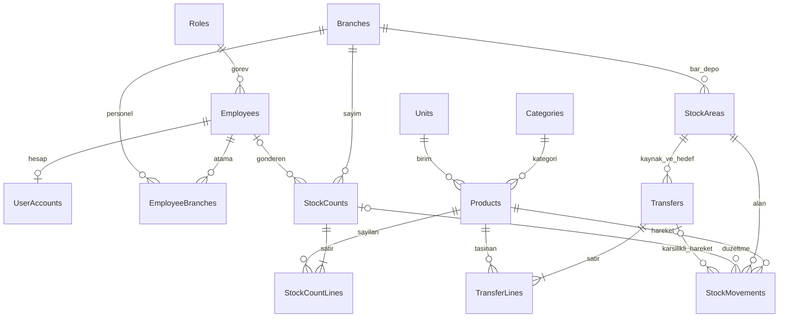

# İlişkisel veritabanı tasarımı

Hedef: SQL Server Express + Entity Framework Core. EF Core modeli ve migration uygulandı. SQL etkinleştirildiğinde bu şema kullanılır; JSON geçiş kaynağı olarak korunur. Canlı SQL doğrulaması Ayarlar ekranından ayrıca yapılmalıdır.

## Tablolar

| Tablo | Temel alanlar | İlişki / kural |
|---|---|---|
| Roles | Id, Name | Görev adı benzersiz |
| Employees | Id, Name, Phone, HireDate, RoleId, IsActive | RoleId → Roles; geçmişi olan personel pasifleştirilir |
| UserAccounts | EmployeeId, Username, UsernameKey, PasswordHash, PasswordSalt, IsEnabled | EmployeeId hem PK hem Employees FK; etkin kullanıcı adı benzersiz; açık şifre yok |
| Branches | Id, Name, Address, IsActive | Şube adı benzersiz; kod kullanıcıya gösterilmez |
| EmployeeBranches | EmployeeId, BranchId | Bileşik PK; aynı kişi birden çok şubede |
| Categories | Id, Name | Kategori adı benzersiz |
| Units | Id, Name | Kg, Adet, Şişe, Koli, Fişek, Paket vb. |
| Products | Id, Name, CategoryId, UnitId, MinimumStock, ImageKey, IsActive | Kategori/birim FK; MinimumStock ≥ 0; geçmişi olan ürün silinmez |
| StockAreas | Id, BranchId, Area | Area yalnız Bar/Depo; (BranchId, Area) benzersiz |
| StockCounts | Id, BranchId, SubmittedById, SubmittedName, SubmittedAt, Status, ReviewedById, ReviewedAt, ReviewNote, IsDemo | Şube FK, kişi FK'leri; eski kişi adı metni korunur; durum bekliyor/onaylandı/reddedildi |
| StockCountLines | CountId, ProductId, ExpectedBar, CountedBar, ExpectedDepot, CountedDepot | Bileşik PK; miktarlar ≥ 0; onaydan önce ürün ve güncel stok kontrolü |
| Transfers | Id, SourceAreaId, TargetAreaId, CreatedById, CreatedAt, Note, IsDemo | Kaynak/hedef farklı; alan ve kişi FK'leri |
| TransferLines | TransferId, ProductId, Quantity | Bileşik PK; Quantity > 0 |
| StockMovements | Id, ProductId, AreaId, OccurredAt, Type, Quantity, Note, ActorId, CountId, TransferId, IsDemo | Ürün/alan FK; miktar işaretli; sayım/transfer bağı isteğe bağlı |
| BusinessSettings | Id, BusinessName | Parola veya bağlantı dizisi içermez |
| MigrationHistory | Id, SourceFingerprint, AppliedAt, ImportedCounts | Aynı JSON aktarımının tekrar çalışmasını önler; kayıt adetleri ve dosya özeti |

## ER ilişkileri

StockCounts tablosunun gönderici ve inceleyen kişi ilişkileri ayrı FK'lerdir. Transfers tablosunda kaynak ve hedef için StockAreas'a iki ayrı FK vardır; ER çizimindeki tek bağlantı bu iki rolü özetler.

## Miktar, güvenlik ve bütünlük

- Miktarlar SQL `decimal(18,6)` olur; float/double kullanılmaz. Aktarım öncesi mevcut değerlerin hassasiyete uyduğu kontrol edilir; fazlası sessizce yuvarlanmaz.
- Birim değişikliği stok geçmişi varsa reddedilir. Tablo ilişkilerinde kısıtlayıcı silme kullanılır; toplu cascade delete ile geçmiş yok edilmez.
- Bakiye, ürün/alan hareket toplamıdır. Ayrıca güncellenen bağımsız bir “bakiye” alanı başlangıçta tutulmaz.
- Onay ve transfer tek transaction içinde yapılır. Aynı alan/ürün için eşzamanlı işlemler kilit sırası ve uygun izolasyonla korunur. Beklenen sayım bakiyesi transaction içinde yeniden kontrol edilir; negatif stok engellenir. Yalnız rowversion kullanılması hareket toplamındaki yarışı çözmez.
- Sayımın durum geçişinde eşzamanlılık kontrolü bulunur; çift onay aynı stoğu ikinci kez değiştiremez.
- Kullanıcı erişim kapsamı servis ve veritabanı sorgularında uygulanır. Görünür düğmeler güvenlik sınırı değildir.
- Hesap hash/salt değerleri mevcut PBKDF2 parametreleriyle taşınır. Aktarım şifreleri 123456'ya sıfırlamaz. Yalnız yeni hesaplar ilk şifre politikasını kullanır.
- Gerçek bağlantı dizisi Git'e yazılmaz. Windows kimlik doğrulaması ve ortam değişkeni/yerel yapılandırma kullanılır.
- Demo kayıtları IsDemo ile tutulur; yalnız açıklama metnine güvenilmez.

## JSON aktarım kabul ölçütleri

1. Üç kaynak dosyası ve mevcut yedekler korunur; bir kaynak özeti oluşturulur.
2. Ürün/personel/şube/hareket/sayım kimlikleri korunur. Kategori/birim gibi yeni sözlüklerin kimlikleri üretilir.
3. Eski Warehouse kayıtları BranchId + Bar/Depo alanına eşlenir. Aynı alanın birden fazla eski Warehouse kaydı varsa hareketler aynı StockAreas kaydına bağlanır; kaynak WarehouseId eşleme kaydı aktarım günlüğünde saklanır.
4. Kişi atamalarında hem Branches hem eski BranchName alanı değerlendirilir; tekrarlar kaldırılır.
5. Kişi kaydıyla eşleşmeyen eski sayım Operator metni SubmittedName içinde korunur; kişi kimliği uydurulmaz. Şubesiz veya ilişkisiz eski kayıtlar sessizce atılmaz; aktarım öncesi sorun listesine alınır.
6. Kayıt adetleri, her ürün/şube/alan bakiyesi ve her sayım satırı kaynakla karşılaştırılır.
7. Aktarım başarısızsa transaction geri alınır. Aynı kaynak yeniden verildiğinde kopya ürün/hareket/hesap oluşturulmaz.
8. Giriş, çoklu şube yetkisi, CRUD, sayım onayı/ret, çift onay, eski bakiye, transfer ve AI sorguları ayrı test DB'sinde doğrulanır.

## Kabul edilmez

- Verilerin tamamını tek SQL tablosundaki JSON kolona koyup ilişkisel geçişi tamamlanmış saymak.
- Uygulama hâlâ JSON okurken yalnız örnek SQL tabloları oluşturarak veritabanı entegrasyonu iddiasında bulunmak.
- Öğrencinin bilgisayarında DevExpress olmadan aynı adlı sahte kontroller kullanmak.
- Sadece çözüm başlığını değiştirerek VS 2026'da test edildiğini söylemek.

## Uygulanan başlangıç modeli
Tablolar cafestock şemasında; ImportedLocations ile eski alan kimlikleri korunuyor. StockCountLines toplam ve nullable Bar/Depo alanlarını eski sayımları eksiksiz taşımak için içeriyor. BusinessSettings üzerinde sürüm kontrolü var. Model/migration kodlandı; canlı SQL Server doğrulaması bekliyor. Güncel kapsam tek Elazığ şubesidir.

